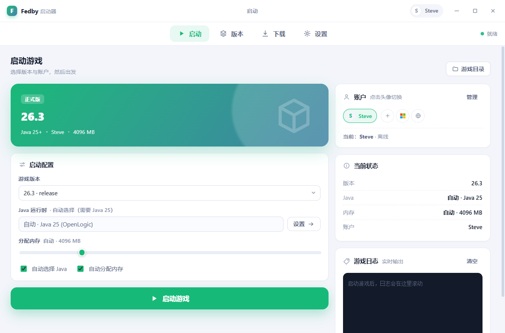
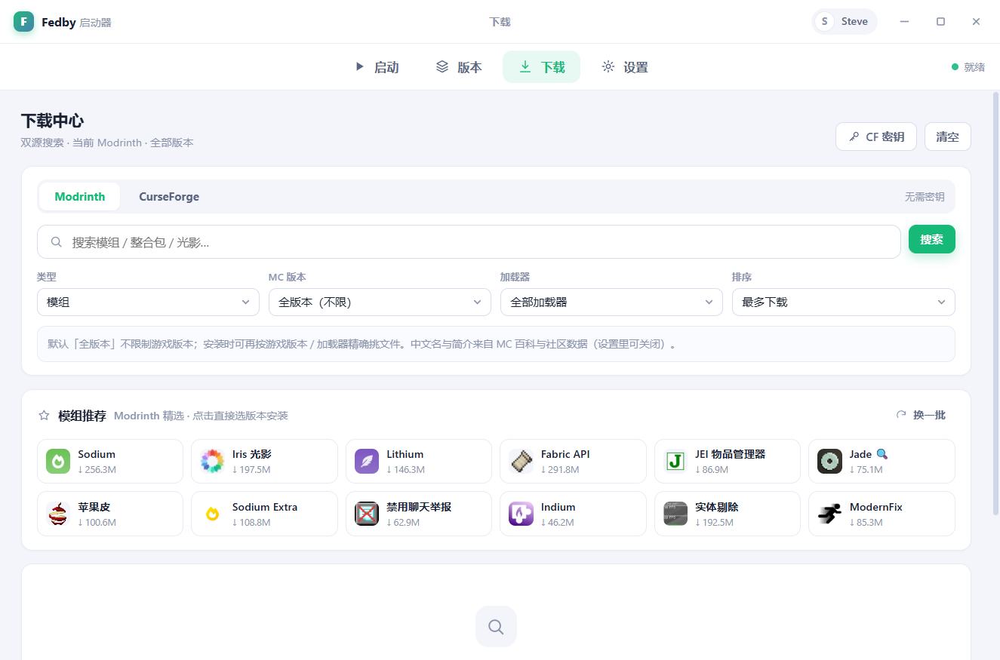
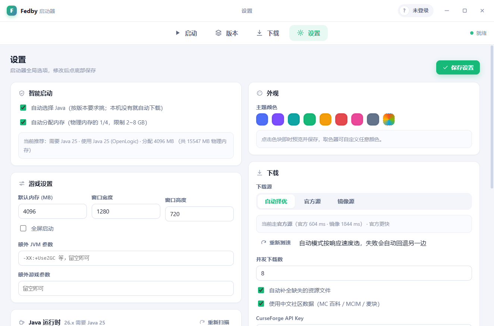

<div align="center">


# Fedby 启动器（Build from DeepSeek）

**一个对标 PCL2 的 Minecraft Java 版启动器 —— 界面清爽、下载省心、开箱能用。**

[](https://github.com/Fedby/fedby-launcher/releases/latest)
[](LICENSE)


[下载](#下载与安装) · [功能一览](#功能一览) · [快速开始](#快速开始) · [常见问题](#常见问题)

</div>



## 这是什么

Fedby 启动器用 Electron + Node.js 写成，只做一件事：让你少折腾地把 Minecraft 开起来。

它自己管理一份独立的游戏目录（`%APPDATA%\FedbyLauncher`），不碰你原来的 `.minecraft`；模组从 Modrinth 和 CurseForge 双源下载、名称直接显示中文；Java 和内存会按版本要求自动挑好，不想让它管的时候一键关掉就行。

## 功能一览

**启动**

- 账户条直接长在主页上，点头像就能换账户
- 版本、Java、内存一屏看完，启动按钮常驻底部
- 实时日志滚动输出，出错能直接看到原因
- 自动选择 Java（按版本的 `javaVersion` 要求取「够用的最低版本」）、自动分配内存（物理内存 1/4，限制 2~8 GB），两者都能关
- **缺 Java 自动补**：本机没有版本要求的 Java（比如 26.x 要 Java 25）时，启动器直接下 Adoptium Temurin，装到自己的目录里，不碰系统环境；下完自动接管，下次直接用
- 装完版本也会顺手把对应的 Java 后台备好，进度在状态栏滚动显示

**版本管理**

- 从 Mojang 官方源安装任意正式版 / 快照，含依赖库与资源文件，逐个 SHA1 校验，多线程下载
- 「检查」弹窗分五个标签：基本信息、模组、资源包、光影、存档；每个标签都能一键打开对应文件夹
- 基本信息页提供版本目录、游戏根目录、模组、资源包、光影、存档、备份七个快捷入口

**下载中心**

- Modrinth 与 CurseForge 双源搜索，支持模组、整合包、资源包、光影、地图、插件、数据包七类资源
- 首页热门模组推荐，点开就能挑版本装
- 模组名显示中文（人工校对词库 → MC百科 → 麦块社区，查不到就老实保留英文），简介优先取 MC百科中文原文
- 安装前可按「游戏版本 + 加载器 + 关键词」三重筛选，默认已匹配当前版本；依赖自动一并装上，重复文件自动跳过



**账户**

- 离线账户：UUID 由用户名稳定生成，存档不会串号
- 微软正版：内置微软官方登录窗口，登录后自动同步皮肤头像，令牌临近过期会静默续期
- 第三方皮肤站：标准 Yggdrasil 协议，支持 LittleSkin / Blessing Skin；配置 `authlib-injector.jar` 后游戏内皮肤也生效

**设置**

- 8 种主题色 + 自定义取色，改完立刻生效
- Java 运行时扫描、手动指定、一键下载对应版本（含删除已下载的运行时）
- 内存与分辨率、全屏、额外 JVM 参数与游戏参数
- 下载并发数、社区中文数据开关、CurseForge API Key、数据目录直达



## 下载与安装

到 [Releases](https://github.com/Fedby/fedby-launcher/releases/latest) 下载：

| 版本 | 适合谁 | 说明 |
|---|---|---|
| `FedbyLauncher-Portable-1.0.0.exe` | 想直接用 | 单文件免安装，双击即运行，可放 U 盘带走 |
| `FedbyLauncher-Setup-1.0.0.exe` | 想长期用 | 安装版，可自选目录，自动创建桌面与开始菜单快捷方式 |

**系统要求**：Windows 10 / 11（64 位）。启动器本体约 300 MB，装游戏本体另需约 800 MB。

**首次使用三步**：

1. 打开启动器 → 点「＋」添加一个离线账户，或点微软徽标登录正版
2. 到「版本」页点「安装版本」，选一个正式版下载（例如最新的 26.x）
3. 回「启动」页点「启动游戏」，第一次会自动配好 Java 和内存

> 启动器本体不自带游戏文件，26.3 之类的版本需要自己下一次（约 800 MB）。之后版本就存在本地，重装启动器也不用重下。

## 从源码运行

```bash
git clone https://github.com/Fedby/fedby-launcher.git
cd fedby-launcher
npm install
npm start
```

> 如果 Electron 启动报 `app is not defined`，是环境里有 `ELECTRON_RUN_AS_NODE` 变量，清掉即可：`set ELECTRON_RUN_AS_NODE=` 后再 `npm start`。

打包成 exe：

```bash
npm run dist            # 安装版 + 便携版
npm run dist:portable   # 只出便携版
```

产物在 `dist/`。图标是 `build/icon.png`，打包时自动生成 7 个尺寸的 ICO；替换图标直接覆盖这张图，或用 `electron tools/convert-icon.js <源图> build/icon.png 512` 转换。

## 数据存放

所有数据集中在 `%APPDATA%\FedbyLauncher`，删掉这个目录就等于恢复出厂设置：

```
config.json        全局配置
accounts.json      账户列表
minecraft/         游戏目录（versions / libraries / assets）
runtimes/          启动器自己下载的 Java（temurin-25 等）
skins/             从皮肤站同步的皮肤贴图
backups/           存档备份
```

模组、资源包、光影、存档统一在「版本 → 检查」里管理，不存在「实例」概念，所有版本共用一个游戏目录。

## 常见问题

**启动时提示找不到 Java？**
开着「自动选择 Java」就不用管：26.x 需要 Java 25、21.x 需要 Java 21，缺哪个启动器会自己下（Adoptium Temurin，约 60 MB，优先走清华镜像，装到 `%APPDATA%\FedbyLauncher\runtimes`，不动系统环境）。关掉自动选择的话，到「设置 → Java 运行时」点「扫描」或手动指定 `java.exe`。

**提示「未知发布者」？**
安装包没有买代码签名证书，Windows 会拦一下。点「更多信息 → 仍要运行」即可。介意的可以自己 `npm run dist` 打包。

**游戏报 401 或 Realms 认证失败？**
离线账户本来就连不上 Realms，单机与局域网联机都不受影响。

**模组显示的是英文名？**
说明人工词库和 MC百科都没有公认中文名（比如 Sodium、Lithium），这种情况下刻意保留英文，避免出现「钠含量较高」这类机翻。

**部分 CurseForge 模组装不上？**
少数作者禁止第三方直链下载，启动器会提示你去项目主页手动下载。

## 技术架构

主进程按职责拆成服务层，渲染层用原生 ES Module，中间只隔一层 IPC：

```
src/main/            Electron 主进程
  index.js           窗口、fedby:// 协议、CSP、外链拦截
  bridge.js          全部 IPC 注册（只做路由与错误包装）
  services/          paths settings net versions java runtime launch
                     content accounts microsoft yggdrasil i18n
                     javadl unzip
                     providers/{modrinth,curseforge,installer}
src/preload.js       contextBridge 暴露 window.fedby
src/renderer/        原生 ES Module：router store shell lib components pages styles
```

几个实现上的取舍：

- **界面走自定义协议 `fedby://`**，不是 `file://`。原生 ES Module 在 `file://` 下会被 CORS 拦掉，注册成标准协议后可以直接 `import`，不需要打包器，顺带能挂 CSP。
- **IPC 统一 `{ ok, data }` / `{ ok, error }`**，渲染层不用到处 try/catch，错误集中在一处提示。
- **26.x 的新式原生库**：natives 是带 classifier 后缀的独立 library 条目，靠 `rules` 按平台筛完全部进 classpath，不是老的 `natives` 嵌套结构。
- **微软登录用授权码流程**，不是设备码。`/devicecode` 要求每个启动器自有且经 Mojang 审批的 Azure 应用，公开的 client id 在 consumers 租户已不存在，拿不到验证码。
- **中文名不机翻**，走「人工词库 → MC百科 → 麦块」，宁缺毋滥。
- **Java 运行时自己管**：按版本 `javaVersion.majorVersion` 判定缺哪个主版本，调 Adoptium API 取 Temurin JRE，SHA256 校验后解压到 `runtimes/`；下载走清华镜像、失败回落 GitHub。解压是手写的 ZIP 解析（store + deflate），不引第三方解压库。

<details>
<summary>开发与验证记录</summary>

测试脚本都在仓库根目录，`node test-xxx.js` 直接跑：

| 脚本 | 用途 |
|---|---|
| `test-services.js` | 无界面跑服务层：版本 / classpath / Java / 命令构建 / 双源搜索 / 中文数据 / 配置 |
| `test-smoke.js` | 启动 Electron（CDP）：四页渲染、首屏自动选择、截图、控制台错误 |
| `test-flow.js` | 下载页推荐与搜索、安装弹窗筛选、版本检查五个标签 |
| `test-mslogin.js` | 微软登录弹窗、真实授权页、回调拦截与错误提示 |
| `test-launch2.js` | 离线账户真实启动 26.3 至主菜单，随后停止并清理 |
| `test-javadl.js` | 真实下载 Java 25：镜像 + SHA256 + 解压 382 个文件 + 探测版本（约 6 秒） |
| `test-java-ui.js` | 设置页「下载 Java」按钮、进度条、运行时徽章与删除 |
| `test-java-launch.js` | 用下载来的 Temurin 真实启动 26.3，验证运行时可用 |
| `test-packaged.js` | 运行 `dist/` 里的打包产物，验证 asar 与协议（可用 `EXE=` 指定便携版） |

v1.0.0 的实测结果：

- 服务层 17 项全通过：26.3 的 114 个库、classpath 74 项零缺失、Java 25 自动匹配、命令 36 个参数无残留占位符、Modrinth 与 CurseForge 搜索均正常、译名为「机械动力 / JEI 物品管理器」
- 界面四页零控制台错误，推荐区 12 张卡、搜索「找到 3.6K 个项目」、安装弹窗默认匹配当前版本
- 端到端启动：离线账户真实进入主菜单（日志出现 `Backend library` / `OpenAL initialized`）
- 打包产物：`win-unpacked` 与便携版均实测启动，`fedby://` 协议在 asar 内读取正常，`app:info` 返回 1.0.0

Java 自动下载的实测结果：

- 清华镜像 206 命中，58.6 MB 包 6 秒下完，SHA256 与 Adoptium 公布值一致
- 解压 382 个文件、179 MB，`java -version` 为 `25.0.5.1`，被扫描识别为 `Java 25 (Eclipse Temurin)`
- 界面：进度条 12～27 次采样连续可见，完成后徽章变「启动器下载」，二次调用直接复用（不重复下载）
- 索引文件被清空时能按 `runtimes/temurin-*` 目录自愈重建
- 用这个运行时启动 26.3：68 行日志、进入主菜单、零控制台错误

</details>

## 许可

[MIT](LICENSE)

Minecraft 是 Mojang Studios 的商标，本项目与 Mojang 及 Microsoft 无关联。启动器不分发任何游戏本体文件。
